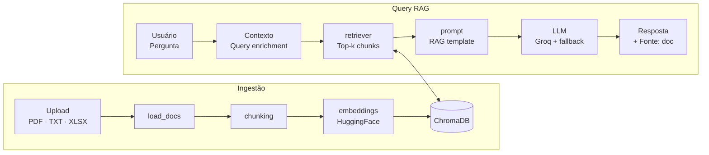

# 🤖 DocMind

Chatbot de RAG (Retrieval-Augmented Generation) construído do zero para responder perguntas sobre documentos PDF, TXT e XLSX, com upload e deleção em tempo real, citação de fonte determinística, memória de conversa e pipeline modular testado.

🔗 **App ao vivo:** [Hugging Face Space](https://huggingface.co/spaces/Felipe-2026/ai-agent-demo)
📂 **Código-fonte:** [GitHub](https://github.com/felipenewplayer/DocMind)

---

## 📋 Sobre o projeto

O DocMind responde perguntas em linguagem natural com base no conteúdo de documentos carregados — sem alucinar informações que não estão nos arquivos. O projeto foi construído para praticar um pipeline RAG completo, ponta a ponta: ingestão, chunking, embeddings, vector store, retrieval, prompt engineering, memória de conversa e deploy real em produção.

### Funcionalidades

- 📄 Suporte a múltiplos formatos: PDF, TXT e XLSX
- 📥 Upload de novos documentos em tempo real pela interface (sem reiniciar o app)
- 🗑️ Deleção de documentos do banco vetorial pela interface
- 🔍 Citação de fonte determinística — cada resposta indica de qual documento a informação veio, extraída do metadata dos chunks, não pelo LLM
- 🧠 Memória de conversa com contextualização de query (perguntas vagas como "me conta mais" funcionam corretamente)
- 🚫 Prompt anti-alucinação (não inventa informações fora dos documentos)
- 📊 Logging estruturado por módulo
- ✅ Suíte de testes automatizados (pytest) com mock de LLM

---

## 🛠️ Stack técnica

| Camada | Tecnologia |
|---|---|
| Interface | Streamlit |
| Orquestração | LangChain |
| LLM | Groq (Llama 3.3 70B + fallback GPT-OSS-120B) |
| Embeddings | HuggingFace (`sentence-transformers/all-MiniLM-L6-v2`) |
| Vector Store | ChromaDB |
| Testes | pytest + unittest.mock |
| CI/CD | GitHub Actions |

---

## 🏗️ Arquitetura

O projeto tem dois fluxos independentes: ingestão de documentos e query RAG.



### Estrutura de módulos

```
src/
├── app/            # Header e sidebar (upload, deleção, lista de docs)
├── load_docs/      # Carrega PDF, TXT, XLSX + upload via interface
├── chunking/       # Divide em chunks + filtra vazios
├── embeddings/     # Modelo HuggingFace (cacheado com @st.cache_resource)
├── vectordb/       # Cria, consulta, adiciona e deleta do ChromaDB
├── ingest/         # Orquestra o pipeline de ingestão inicial
├── retrieval/      # Retriever com contextualização de query
├── llm/            # ChatGroq com fallback configurado
├── prompt/         # Template do prompt RAG anti-alucinação
logs/
├── logs_config.py  # Logging centralizado com fuso horário SP
tests/
├── unitario/       # Testes de funções puras (sem dependência externa)
├── integracao/     # Testes com mock de LLM (sem custo de API)
```

### Decisões de design

**Citação de fonte determinística:** a fonte é extraída do `metadata["source"]` dos chunks recuperados pelo retriever, não pedida ao LLM. Isso elimina risco de alucinação na citação e garante rastreabilidade real.

**Contextualização de query:** antes de buscar no ChromaDB, o sistema detecta se a pergunta menciona o nome de um documento específico. Se sim, busca com a pergunta pura (mais precisa). Se não, enriquece com o histórico da conversa (resolve perguntas vagas como "me conta mais").

**Memória de conversa:** implementada via `format_history()`, injetada no prompt como contexto adicional, em vez de usar `RunnableWithMessageHistory`. Escolha deliberada para o estágio atual do projeto.

**Cache em camadas:** `load_embeddings()`, `get_db()` e `get_documentos_disponiveis()` são cacheados com `@st.cache_resource`/`@st.cache_data` individualmente, permitindo invalidação cirúrgica após add/delete sem derrubar o modelo de embeddings.

---

## ✅ Testes

```bash
pytest tests/ -v
```

| Módulo | Tipo | Cenários cobertos |
|---|---|---|
| `format_history()` | Unitário | Lista vazia, histórico normal, corte por limite |
| `split_into_chunks()` | Unitário | Texto curto (1 chunk), texto longo (múltiplos chunks) |
| `filter_empty_chunks()` | Unitário | Remoção de chunks vazios ou só com espaço |
| `get_llm()` | Integração mockada | Instância correta, fallback configurado, `.invoke()` funcional |

Os testes de integração usam `unittest.mock.patch` para simular o comportamento do `ChatGroq` sem fazer chamadas reais à API — validam a lógica da chain sem custo de token.

---

## 🔄 CI/CD

Pipeline de integração e entrega contínua com **GitHub Actions**, dois estágios sequenciais:

1. **CI:** a cada push na branch `main`, os testes rodam em ambiente Linux limpo.
2. **CD:** se os testes passarem, o deploy para o Hugging Face Spaces acontece automaticamente.

Credenciais sensíveis (`GROQ_API_KEY`, `HF_TOKEN`) são gerenciadas via **GitHub Secrets**, nunca expostas no código.

> ⚠️ Ao rotacionar a `GROQ_API_KEY`, atualizar em três lugares: `.env` local, GitHub Actions secrets e Hugging Face Space secrets (com restart manual do Space após o último).

```yaml
jobs:
  test:
    runs-on: ubuntu-latest
    # roda pytest tests/ -v

  deploy:
    needs: test  # só executa se os testes passarem
    runs-on: ubuntu-latest
    # push automático para o Hugging Face
```

---

## 🚀 Rodando localmente

```bash
git clone https://github.com/felipenewplayer/DocMind
cd DocMind
python -m venv venv
.\venv\Scripts\activate  # Windows
pip install -r requirements.txt
```

Crie um `.env` na raiz:

```
GROQ_API_KEY=sua_chave_aqui
```

Rode o app:

```bash
streamlit run app.py
```

---

## 👤 Autor

Felipe — [GitHub](https://github.com/felipenewplayer) · [LinkedIn](https://www.linkedin.com/in/felipe-pereira-6a7828255/)